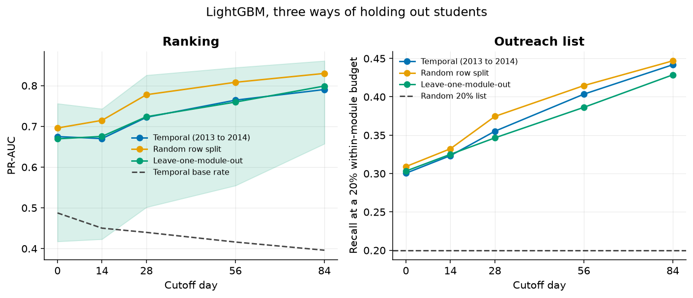
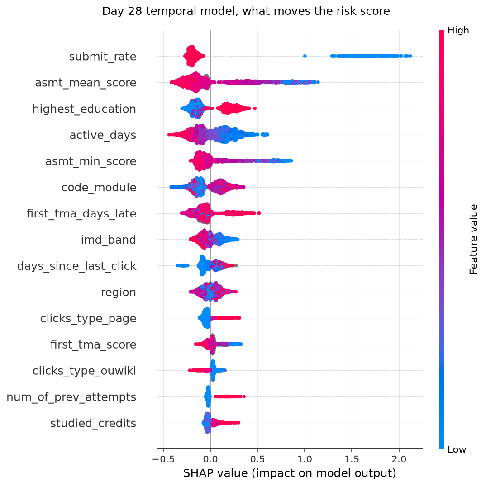
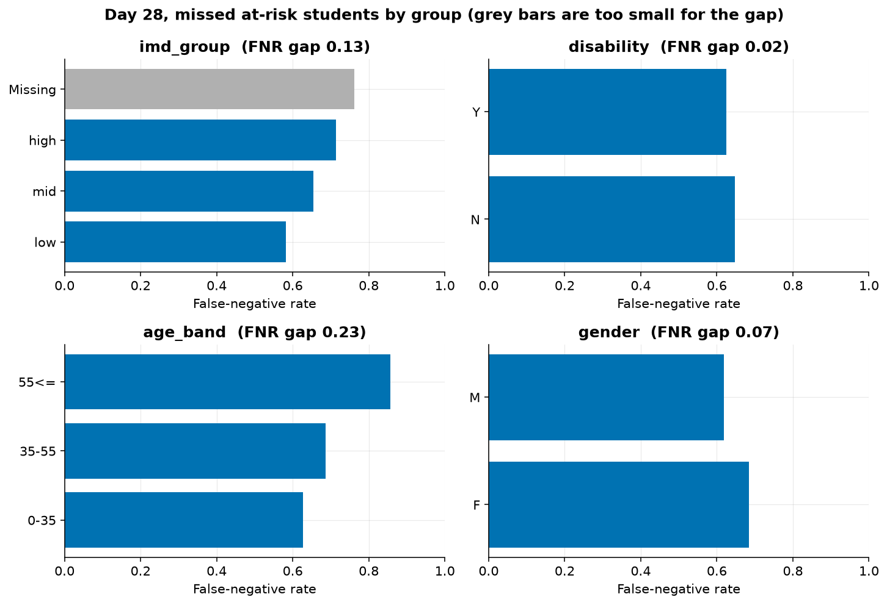
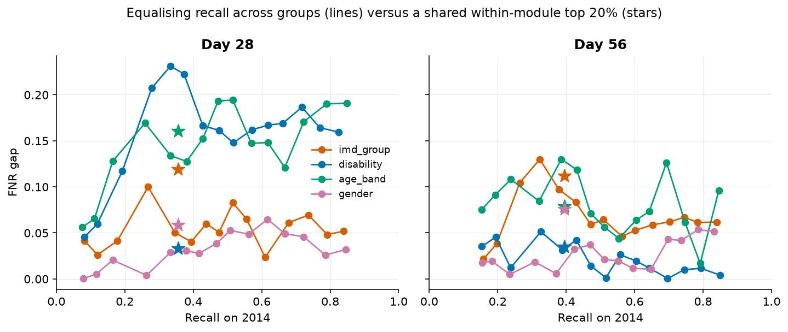

# Student Dropout Early-Warning System

An end-to-end machine-learning project that identifies students at risk of **failing or withdrawing** while there is still time for tutor outreach. It uses the Open University Learning Analytics Dataset (OULAD), containing 32,593 registrations and 10.6 million learning-platform records.

The operational question is:

> If a tutor can contact only 20% of the students in each module, who should be prioritized—and does that list systematically miss any demographic group?

The system builds leakage-safe snapshots at days 0, 14, 28, 56, and 84; compares Logistic Regression with LightGBM; validates performance across time and unseen modules; and audits false-negative rates across socioeconomic status, age, gender, and disability.

## Headline results

- **Day-28 temporal test:** 0.722 PR-AUC, 0.762 ROC-AUC, and 35.5% recall within a 20% outreach budget.
- **Why the split matters:** a random row split reports 0.778 PR-AUC because it has already seen every module presentation; the 2013-to-2014 temporal split is the result to quote.
- **Interpretability:** submission rate, assessment scores, prior education, and active days are the strongest day-28 drivers.
- **Fairness:** the socioeconomic false-negative-rate gap is 0.131 at day 28, compared with 0.284 at day 0.



## Dataset

The [original OULAD release](https://archive.ics.uci.edu/dataset/349/open+university+learning+analytics+dataset) contains 32,593 registrations from 28,785 students, 10,655,280 VLE records, and 22 module presentations. The Open University download links now return 404, so the download script uses the UCI mirror of the same release and verifies the expected row counts.

The Kaggle extract adds a `vle.title` field containing placeholder text. The pipeline does not use it and drops it if present.

Final results in the file: Pass 12,361, Withdrawn 10,156, Fail 7,052, Distinction 3,024.

### Cohort definition

`date_unregistration` is an eligibility rule, not a feature.

- 2,678 students unregistered before day 0 and are excluded because they never started.
- The main model also excludes anyone who has already left by the cutoff; a tutor does not need a model to identify them.
- At day 28, 27,538 students remain eligible and 44.1% eventually fail or withdraw.
- A sensitivity model that keeps students who have already withdrawn raises PR-AUC from 0.722 to 0.811, demonstrating how an incorrect cohort can inflate performance.
- 93 rows are labelled Withdrawn but have no unregistration date. They stay in, because the date rule cannot see them.
- 1,909 banked assessment scores are treated as known from day 0, so a transfer date cannot hide them.

Eligible cohort and base rate, students still enrolled:

| Cutoff | Students | At-risk rate |
| --- | ---: | ---: |
| Day 0 | 29,496 | 0.478 |
| Day 14 | 28,119 | 0.453 |
| Day 28 | 27,538 | 0.441 |
| Day 56 | 26,522 | 0.420 |
| Day 84 | 25,724 | 0.402 |

The base rate falls because early departures are disproportionately at risk. Later models therefore score a smaller, harder cohort.

## Leakage-safe features

Every time-dependent feature is created inside `build_features(cutoff)`:

- Clicks after the cutoff are excluded. Totals are the cumulative sum through the last day at or before the cutoff.
- The last-seven-day window is the seven days ending on the cutoff.
- Clicks before day 0 are a separate pre-start total.
- Assessment scores count only when `date_submitted` is at or before the cutoff. Exams are excluded: they are the end of the module and are missing for most students.
- An assessment is "due" only when its scheduled date is at or before the cutoff. That calendar is known in advance.
- `final_result` is the label only. `id_student` and `code_presentation` are not features. `code_module` is a feature. `imd_group` is used in the audit and is not a model input.

- **Static:** demographics, prior attempts, studied credits, module, and registration date.
- **Engagement:** total and recent clicks, active days, activity-type counts, pre-start clicks, and time since the last click.
- **Assessment:** scores available by the cutoff, submission rate, assessments due, and first-assignment lateness or absence.

## Modeling and evaluation

Models are evaluated at cutoffs 0, 14, 28, 56, and 84 using three complementary splits:

- **Temporal (primary):** train on 2013B/2013J and test on 2014B/2014J.
- **Leave-one-module-out:** test whether a model transfers to a module absent from its training data.
- **Random (diagnostic):** a stratified 70/30 row split included to demonstrate optimistic performance when presentations overlap.

The outreach rule selects the top 20% **inside each module**, preventing one difficult module from consuming the university-wide contact budget. The primary metrics are PR-AUC, ROC-AUC, and recall within that outreach budget.

The baseline is class-weighted Logistic Regression with imputation, scaling, one-hot encoding, and log-transformed click counts. The main model is LightGBM. A small search on 2013B/2013J selects its parameters once at day 28; the same configuration is then reused across cutoffs and splits to avoid repeatedly tuning on each evaluation setting.

## Predictive performance

LightGBM on the 2014 presentations:

| Day | Test rows | Base rate | PR-AUC | ROC-AUC | Recall at 20% |
| --- | ---: | ---: | ---: | ---: | ---: |
| 0 | 17,195 | 0.487 | 0.675 | 0.688 | 0.300 |
| 14 | 16,027 | 0.450 | 0.670 | 0.711 | 0.323 |
| 28 | 15,729 | 0.440 | 0.722 | 0.762 | 0.355 |
| 56 | 15,092 | 0.416 | 0.764 | 0.800 | 0.403 |
| 84 | 14,590 | 0.396 | 0.790 | 0.831 | 0.442 |

A random 20% list would recall 20% of at-risk students. At day 28, the model identifies 35.5%—about 1.8 times the random-selection baseline.

Logistic Regression remains competitive: at day 28 it reaches 0.700 PR-AUC and 35.2% recall, compared with 0.722 and 35.5% for LightGBM. The small difference is an important result—the engineered features carry much of the predictive signal.

The random split reaches 0.778 PR-AUC at day 28. Because it shares every presentation with training, this is an optimistic estimate rather than the headline result.

Leave-one-module-out at day 28 averages PR-AUC 0.724 and recall 0.346, in line with the temporal result, but the modules do not agree. Held-out PR-AUC runs from 0.50 on GGG and 0.55 on AAA to 0.82 on CCC and DDD. A single cross-module number hides that.

CCC has no 2013 presentation, so it is unseen in the temporal training set. At day 28 its PR-AUC is 0.824 and its recall is 0.344, against 0.687 and 0.359 on the modules the model has seen. CCC's base rate is also higher (0.523 against 0.415), so the higher PR-AUC is not pure evidence of easy transfer. ROC-AUC is higher too (0.813 against 0.747).

SHAP identifies submission rate, assessment scores, prior education, and active days as the strongest day-28 drivers. Feature-family gain also changes over time: day 0 is dominated by early engagement and background variables, while assessment features account for 48% of the gain by day 28.



## Fairness

The audit covers socioeconomic status, declared disability, age, and gender. The harm metric is the **false-negative rate (FNR)**: the share of at-risk students omitted from the outreach list. Groups enter a reported gap only when they contain at least 50 students and 20 at-risk students.

Day-28 temporal LightGBM, 2014 test:

| Group | Level | Students | At risk | Selection rate | FNR |
| --- | --- | ---: | ---: | ---: | ---: |
| Deprivation | low | 4,768 | 2,450 | 0.275 | 0.582 |
| Deprivation | mid | 6,231 | 2,704 | 0.192 | 0.654 |
| Deprivation | high | 4,119 | 1,579 | 0.140 | 0.713 |
| Disability | N | 14,239 | 6,109 | 0.195 | 0.648 |
| Disability | Y | 1,490 | 805 | 0.242 | 0.625 |
| Age | 0–35 | 10,943 | 5,018 | 0.217 | 0.628 |
| Age | 35–55 | 4,668 | 1,854 | 0.162 | 0.687 |
| Age | 55<= | 118 | 42 | 0.093 | 0.857 |
| Gender | F | 6,668 | 2,751 | 0.186 | 0.685 |
| Gender | M | 9,061 | 4,163 | 0.210 | 0.618 |

The socioeconomic FNR gap is 0.131 at day 28. Students from the least-deprived band have a 0.713 FNR, compared with 0.582 in the most-deprived band. The gap is 0.284 at day 0 and narrows as behavioral and assessment evidence becomes available.

Disability is nearly balanced (gap 0.023). The gender gap is 0.067. The age gap is larger (0.230), but the oldest test group contains only 42 at-risk students, so that estimate is unstable.



### Dropping the attributes

Refitting the temporal model without gender, age, disability, and IMD band, and then also without region and prior education, barely changes ranking. Day-28 PR-AUC goes from 0.722 to 0.720 to 0.719. The gaps do move.

| Gap at day 28 | Full model | Drop protected | Also drop proxies |
| --- | ---: | ---: | ---: |
| Deprivation | 0.131 | 0.063 | 0.037 |
| Age | 0.230 | 0.102 | 0.146 |
| Disability | 0.023 | 0.018 | 0.005 |
| Gender | 0.067 | 0.069 | 0.060 |

Removing protected fields reduces some gaps without materially changing PR-AUC, but it does not eliminate all disparities. This shows why excluding a protected column is not a complete fairness strategy.

### Equalising recall

As an illustrative mitigation, the model is trained on 75% of the 2013 data and group-specific thresholds are selected on the remaining 25%, then evaluated on 2014. Groups with fewer than 20 positive validation cases retain the global threshold.

At day 28 that unmitigated list has recall 0.356 and these gaps: deprivation 0.119, age 0.160, gender 0.058, disability 0.033.

The operating point is the smallest test gap among selection rates between 15% and 25%:

| Day 28 | Recall | Selection | FNR gap |
| --- | ---: | ---: | ---: |
| Deprivation, group thresholds | 0.394 | 0.232 | 0.040 |
| Age, group thresholds | 0.381 | 0.220 | 0.127 |
| Gender, group thresholds | 0.417 | 0.247 | 0.028 |
| Disability, group thresholds | 0.373 | 0.219 | 0.223 |

Group thresholds reduce the socioeconomic gap from 0.119 to 0.040 and the gender gap from 0.058 to 0.028. They make the disability result worse, illustrating that a mitigation can fail to transfer. These thresholds are an analysis of the tradeoff, not a deployment recommendation.



## Exploratory findings

Outcome mix differs sharply by module. Weekly clicks separate the four final-result groups even when calculated only among students still registered that week. First-assignment scores are higher among students who pass, while 46% of students who withdraw never submit that assignment.

The Kaplan–Meier and engagement-cluster figures are retrospective descriptions, not model features. Their full-horizon information would leak the future into an early-warning model.

## Technology and repository structure

**Python, Pandas, NumPy, Scikit-learn, LightGBM, SHAP, Fairlearn, Matplotlib, Seaborn, PyArrow, Jupyter**

```text
├── notebooks/          # Executed EDA, modeling, and fairness notebooks
├── reports/
│   ├── figures/        # Saved visualizations
│   └── *.csv, *.json   # Metrics and audit outputs
├── scripts/            # Download, pipeline, and notebook helpers
├── src/oulad/
│   ├── features.py     # Cutoff-safe feature construction
│   ├── modeling.py     # Logistic Regression, LightGBM, and SHAP
│   ├── fairness.py     # Group metrics, ablation, and mitigation
│   └── pipeline.py     # End-to-end orchestration
└── tests/              # Leakage, metric, model, and fairness checks
```

## Limitations

- Most students have no exam score in the file. The label is the recorded final result, not a mark.
- Withdrawn and Fail are different events. One stops early, the other stays and does not pass. A single at-risk label is what a contact list acts on, and it hides that difference. The sensitivity fit is the quantitative version of this warning.
- The VLE activity types are specific to this platform. A model that leans on `oucontent` clicks will not transfer to another university's logs.
- The group-threshold mitigation was not tuned on 2014, and it is not a deployment recommendation. On disability it makes the test gap worse.
- The age gap depends on a band with a few dozen at-risk students in the test year.
- About 9% of temporal test rows reuse a student id from training, on another module.
- The booster is intentionally small (50 trees). A larger search might move the metrics. It would not change the split design or the direction of the gaps.
- CCC is the only module absent from 2013, so "unseen module" is one course with a high base rate, not a general transfer test. Leave-one-module-out is the broader check, and GGG is where it fails.

## How to run

```bash
git clone https://github.com/anoopsachdev/student-dropout-early-warning.git
cd student-dropout-early-warning
python3 -m venv .venv
.venv/bin/pip install -r requirements.txt
.venv/bin/python scripts/download_oulad.py
mkdir -p .mpl
MPLCONFIGDIR="$PWD/.mpl" PYTHONPATH=src .venv/bin/python scripts/run_pipeline.py
```

Skip the download if `data/raw/oulad_uci.zip` or the seven CSVs are already present. `data/raw/` and `data/processed/` are gitignored. The pipeline writes `reports/metrics.csv`, `reports/fairness_groups.csv`, `reports/ablation.csv`, `reports/mitigation.csv`, `reports/results.json`, and the figures under `reports/figures/`.

`--stage eda`, `--stage models`, or `--stage fairness` reruns one part. `--rebuild` ignores feature and score caches.

Notebooks read those artifacts and recompute the day-28 metrics from the saved scores:

```bash
.venv/bin/python -m ipykernel install --sys-prefix --name oulad --display-name oulad
mkdir -p .ipython
JUPYTER_PATH="$PWD/.venv/share/jupyter" IPYTHONDIR="$PWD/.ipython" \
MPLCONFIGDIR="$PWD/.mpl" PYTHONPATH=src .venv/bin/jupyter nbconvert \
  --to notebook --execute --inplace \
  notebooks/01_eda.ipynb notebooks/02_model.ipynb notebooks/03_fairness.ipynb \
  --ExecutePreprocessor.kernel_name=oulad --ExecutePreprocessor.timeout=1800
```

Tests, including a synthetic check that future clicks and future scores do not change features:

```bash
MPLCONFIGDIR="$PWD/.mpl" OMP_NUM_THREADS=1 PYTHONPATH=src \
  .venv/bin/python -m unittest tests.test_core -v
```
